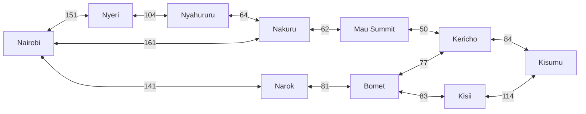
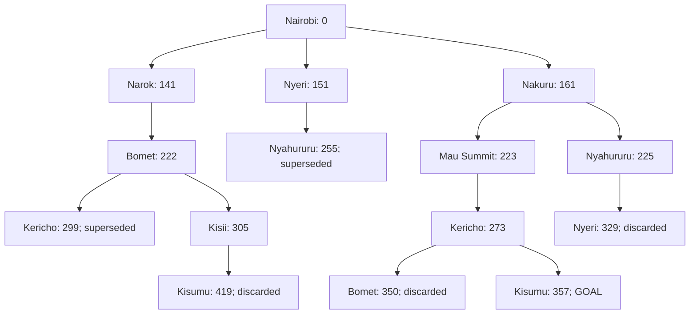

## Designing a Searching Agent

### Scope and assumptions

The agent is an autonomous tractor and trailer delivering cargo from Nairobi to Kisumu. It formulates a goal, formulates a search problem, searches for a route and executes the resulting actions.

This document uses a selected, abstract highway graph based on the class map. Intermediate towns and junctions can be compressed into one edge. All represented roads are assumed open, legal for the trailer and traversable in both directions. Reverse distances are assumed equal.

## 1. PEAS framework

| Component | Design |
| --- | --- |
| **Performance measure** | Deliver cargo safely and intact to Kisumu; avoid collisions and injury; obey traffic laws and trailer restrictions; minimize road distance among feasible routes. Fuel use and delivery time are secondary operational measures. |
| **Environment** | Kenya's highways, towns, junctions, lanes, bridges, gradients, loading areas, other vehicles, pedestrians, cyclists, animals, signs, signals, roadworks, weather and road conditions. |
| **Actuators** | Steering, throttle, brakes for tractor and trailer, parking brake, gear selection, indicators, lights, horn and wipers. |
| **Sensors** | Cameras, radar and lidar; GNSS/GPS and digital maps; wheel-speed, inertial and steering-angle sensors; brake, tyre-pressure and load sensors. |

The route planner selects a sequence of towns. A driving controller translates each road segment into safe steering, acceleration and braking actions. A closure or new restriction triggers replanning.

### Five environment classifications

| Dimension | Classification | Reason |
| --- | --- | --- |
| Fully/partially observable | **Partially observable** | Sensors cannot observe all distant hazards, hidden objects or other drivers' intentions. |
| Deterministic/stochastic | **Stochastic** | Traffic, weather, traction and other road users make action outcomes uncertain. |
| Episodic/sequential | **Sequential** | Every route choice and driving action influences later states and decisions. |
| Static/dynamic | **Dynamic** | Traffic and road conditions can change while the agent plans. |
| Discrete/continuous | **Continuous** | Position, speed, steering and time vary continuously during driving. |

For town-level search only, the graph is assumed fully observable, deterministic, sequential, static and discrete. These simplifying assumptions must not be confused with actual driving conditions. The real environment is also multi-agent because other road users make decisions; this is an additional dimension beyond the five above.

## 2. Directed graph and search tree

### 2.1 Problem formulation

- **Initial state:** Nairobi.
- **Goal:** reach the delivery destination in Kisumu with cargo intact.
- **State space:** the towns in the graph below.
- **Actions:** travel along a feasible outgoing arc to a neighbouring town.
- **Transition model:** travelling from town u to town v changes the planning state to v.
- **Goal test:** current town equals Kisumu; execution must also reach the actual delivery location.
- **Step cost:** distance of the chosen road segment in kilometres.
- **Path cost:** sum of all step costs on the route.

The selected towns cover Nairobi, the Central Highlands (Nyeri and Nyahururu), the Rift Valley (Nakuru, Mau Summit, Narok and Bomet), and the Lake Victoria Basin and its approaches (Kisumu, Kisii and Kericho).

### 2.2 Abstraction

Represent each town as one state and each selected road corridor as one action. Nairobi to Nakuru, for example, compresses intermediate locations such as Naivasha into one arc. Individual buildings, lane markings, steering movements and continuous vehicle positions are omitted from town-level search.

Abstraction must preserve the route choices needed for the problem. A route must not be removed merely because it looks longer: compare costs first. This selected graph does not represent every route in Kenya, so its optimality claim is limited to the alternatives included.

### 2.3 Weighted directed graph

Every double-ended connection denotes **two directed arcs**, one in each direction. Labels are kilometres. The distance table below is the authoritative list of edges.

The graph contains cycles and multiple ways to reach the same town.

### 2.4 Search tree

This tree records uniform-cost graph search until Kisumu is settled. Labels show cumulative cost g. Immediate returns to the parent are omitted. Repeated towns correspond to different action sequences, not different physical towns.

The algorithm retains the cheapest known path to each town. For example, reaching Nyahururu through Nakuru costs 225 km, improving the earlier 255 km route through Nyeri. More expensive duplicates are not expanded. The physical graph remains cyclic even though the search record is a tree.

## 3. Shortest route using distance

### 3.1 Distances

Every row supplies both directed arcs. Published distances are approximate; values with decimals are rounded to whole kilometres. 

| Town pair | Distance used (km) |
| --- | ---: |
| Nairobi - Nakuru | 161 |
| Nairobi - Nyeri | 151 |
| Nyeri - Nyahururu | 104 |
| Nyahururu - Nakuru | 64 |
| Nakuru - Mau Summit | 62 |
| Mau Summit - Kericho | 50 |
| Kericho - Kisumu | 84 |
| Nairobi - Narok | 141 |
| Narok - Bomet | 81 |
| Bomet - Kericho | 77 |
| Bomet - Kisii | 83 |
| Kisii - Kisumu | 114 |

### 3.2 Algorithm

Use **uniform-cost search**, implemented as Dijkstra's algorithm for this graph. Its frontier is a priority queue ordered by accumulated distance g. Start with Nairobi at zero; repeatedly remove the lowest-cost unsettled town and relax its outgoing arcs. Update a neighbour and its predecessor only when a cheaper route is found. Skip stale queue entries.

Stop when Kisumu is removed as the lowest-cost unsettled entry, rather than when it is first generated. All weights are positive, so a settled town's shortest distance is final. Breadth-first search minimizes edge count rather than kilometres and does not guarantee the required optimum with unequal weights.

### 3.3 Search trace

| Step | Town settled | Cost from Nairobi (km) | Successful updates |
| --- | --- | ---: | --- |
| 1 | Nairobi | 0 | Narok 141; Nyeri 151; Nakuru 161 |
| 2 | Narok | 141 | Bomet 222 |
| 3 | Nyeri | 151 | Nyahururu 255 |
| 4 | Nakuru | 161 | Mau Summit 223; Nyahururu improved to 225 |
| 5 | Bomet | 222 | Kericho 299; Kisii 305 |
| 6 | Mau Summit | 223 | Kericho improved to 273 |
| 7 | Nyahururu | 225 | None |
| 8 | Kericho | 273 | Kisumu 357 |
| 9 | Kisii | 305 | None; Kisumu via Kisii would cost 419 |
| 10 | Kisumu | 357 | Goal settled; stop |

### 3.4 Result

**Nairobi -> Nakuru -> Mau Summit -> Kericho -> Kisumu**

| Segment | Distance (km) | Cumulative distance (km) |
| --- | ---: | ---: |
| Nairobi -> Nakuru | 161 | 161 |
| Nakuru -> Mau Summit | 62 | 223 |
| Mau Summit -> Kericho | 50 | 273 |
| Kericho -> Kisumu | 84 | 357 |

**Total = 161 + 62 + 50 + 84 = 357 km.**

| Alternative route | Calculation (km) | Total (km) |
| --- | --- | ---: |
| Nairobi -> Narok -> Bomet -> Kericho -> Kisumu | 141 + 81 + 77 + 84 | 383 |
| Nairobi -> Narok -> Bomet -> Kisii -> Kisumu | 141 + 81 + 83 + 114 | 419 |
| Nairobi -> Nyeri -> Nyahururu -> Nakuru -> Mau Summit -> Kericho -> Kisumu | 151 + 104 + 64 + 62 + 50 + 84 | 515 |

Dijkstra's search establishes optimality across the defined graph, including paths not listed in this comparison. It does not establish the exact shortest route across every Kenyan road. Alternatives through Londiani/Koru and other omitted corridors require additional measured edges before making that broader claim.

### 3.5 Execution

Follow the predecessor chain backward from Kisumu and reverse it to reconstruct the route. The driving controller follows the selected segments while continuously sensing hazards and obeying road rules. If a road closure or trailer restriction makes an arc infeasible, update the graph and search again. Minimum distance applies only among safe, legal and feasible routes.
